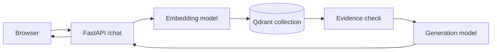

# Capstone: Build an End-to-End AI Learning Assistant

This capstone connects the ideas from the nine modules into one small, explainable application. You will build a service that accepts a question, retrieves relevant lesson content, generates a grounded answer, and records enough information to debug the result.

## Learning Objectives

By the end of the project, you will be able to:

- Turn a product question into measurable technical requirements.
- Separate ingestion, retrieval, generation, and presentation layers.
- Store embeddings and metadata in a vector database.
- Add refusal behavior when evidence is weak or unavailable.
- Test an AI feature with fixtures before using paid APIs.
- Package a service with FastAPI and Docker.

## Prerequisites

Complete Modules 1, 2, 4, 6, and 8. You should know Python functions, Pandas basics, train and test separation, HTTP APIs, environment variables, embeddings, and RAG.

## Project Brief

Build a learning assistant for a small collection of Markdown lessons. A student asks a question such as “What is overfitting?” The application should:

1. Validate the request.
2. Create a query embedding.
3. Search the vector database.
4. Reject weak evidence.
5. Generate an answer from the accepted lesson chunks.
6. Return citations that link back to the lesson.

The assistant must refuse questions outside the lesson collection and must return a temporary service message when its dependencies are unavailable.

## Architecture



Each boundary has one responsibility. The browser displays the answer. FastAPI validates requests and hides credentials. Qdrant retrieves stored evidence. The generation model explains accepted evidence.

## Phase 1: Define the Contract

Write the request and response before writing the implementation.

```json
{
  "question": "What is data leakage?",
  "session_id": "student-001",
  "include_citations": true
}
```

```json
{
  "answer": "...",
  "citations": [
    {
      "title": "Machine Learning",
      "source_route": "/docs/module-04-machine-learning",
      "section": "The ML Workflow"
    }
  ],
  "grounded": true
}
```

Decide how the service behaves for four states: successful evidence, missing lesson content, unrelated questions, and dependency failure. A clear state model prevents the frontend from treating every problem as a generic error.

## Phase 2: Prepare the Documents

For each lesson, preserve its relative path, title, module, heading, content hash, and source route. Split long documents at meaningful boundaries. A chunk should normally contain a complete explanation, definition, table, or code example.

Use deterministic identifiers:

```python
import hashlib

document_id = hashlib.sha256(relative_path.encode()).hexdigest()[:24]
chunk_id = hashlib.sha256(f"{document_id}:{content_hash}:{index}".encode()).hexdigest()[:24]
```

Deterministic IDs make repeated indexing safe. A changed document can replace its own chunks without touching another lesson.

## Phase 3: Choose Evaluation Questions

Create a small evaluation table before indexing:

| Question | Expected result |
| --- | --- |
| What is a Python list? | Answer with a Module 1 citation |
| Why do we split train and test data? | Answer with a Module 4 citation |
| What is RAG? | Answer with a Module 8 citation |
| What is the capital of France? | Out of scope refusal |
| Explain quantum error correction | Related or missing content refusal |

The expected result is part of the test. Checking only whether an answer is non-empty cannot detect hallucinations.

## Phase 4: Implement Evidence Checks

Similarity is a useful signal, not a guarantee. Inspect the retrieved text and require a minimum score, a non-empty source, and a meaningful overlap with the question's concepts. For difficult questions, retrieve several chunks and compare their source sections.

```python
def has_evidence(chunks, threshold=0.70):
    accepted = [
        chunk for chunk in chunks
        if chunk.get("score", 0.0) >= threshold
        and chunk.get("content", "").strip()
        and chunk.get("metadata", {}).get("source_route")
    ]
    return accepted
```

If evidence is contradictory, explain the conflict and cite both sections. If evidence is absent, stop before generation.

## Phase 5: Build and Test the API

Test the pipeline with a fake embedder, fake Qdrant store, and fake generator. Unit tests should cover empty questions, stable IDs, repeated indexing, stale document deletion, weak retrieval, service failures, and fabricated citation protection.

Then run an integration test with a local Qdrant instance. Record the collection name, vector size, number of documents, number of chunks, and the answer returned for each evaluation question.

## Phase 6: Add the Interface

The interface should show the answer, source links, and the current state. Use different messages for loading, missing content, out of scope questions, and service errors. Do not hide a configuration problem behind a successful looking empty answer.

## Common Mistakes

- Indexing without storing the source route.
- Changing the embedding dimension without rebuilding the collection.
- Sending API keys to browser code.
- Treating a high similarity score as proof.
- Letting retrieved text override system rules.
- Testing only successful questions.
- Replacing an old document before all new embeddings have succeeded.

## Extension Tasks

1. Add feedback buttons and store only anonymized evaluation results.
2. Add a module filter to retrieval.
3. Measure citation precision: does each citation support the answer?
4. Add a dashboard showing ingestion errors and collection size.
5. Compare dense retrieval with keyword retrieval on the evaluation set.

## Final Review Questions

1. Why must the embedding model and Qdrant vector size agree?
2. Why should the test set remain untouched during model selection?
3. What should the service return when Qdrant is unavailable?
4. Why are deterministic chunk IDs useful during incremental indexing?
5. What evidence is needed before an answer can be called grounded?
